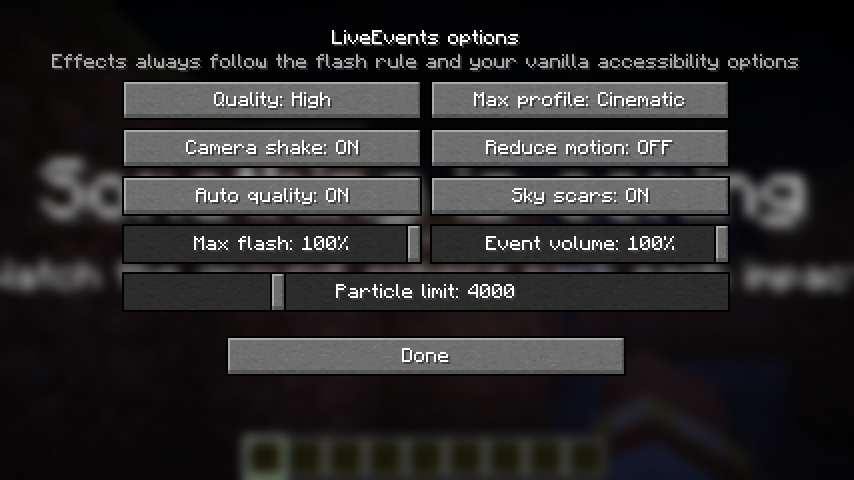

# Configuración

## Servidor: `config/liveevents/server.json`

Se crea al arrancar. Los valores fuera de rango se corrigen con un aviso en el log y, si el archivo está corrupto, se
copia a `server.json.bak` y se regenera: nunca produce un crash. `/le reload` lo vuelve a leer sin reiniciar.

| Campo | Por defecto | Descripción |
|---|---|---|
| `max_concurrent_events` | `2` | Instancias simultáneas en todo el servidor (1–16) |
| `tick_budget_ms` | `2.0` | Tiempo máximo de trabajo del mod por tick (0,2–20) |
| `max_block_changes_per_tick` | `256` | Tope de cambios de bloque por tick |
| `respect_protections` | `true` | Respetar `excluded_regions` y la API de protección |
| `excluded_regions` | `[]` | Zonas donde ningún evento cambia bloques (ver abajo) |
| `damage_in_protected_regions` | `true` | Si el daño de los eventos se aplica dentro de las zonas excluidas |
| `journal_expiry_days` | `7` | Días que se guardan los diarios de cambios |
| `default_world_mode` | `revert_manual` | `permanent`, `revert_on_end` o `revert_manual` |
| `photosensitivity_notice` | `true` | Aviso de fotosensibilidad la primera vez que un jugador ve un evento |
| `audit_log` | `true` | Registro de auditoría en `logs/` |
| `audit_retention_days` | `30` | Días que se guarda la auditoría |
| `default_profile` | `gameplay` | Perfil cuando el comando no indica ninguno |
| `max_profile` | `cinematic` | Perfil máximo permitido en el servidor |
| `sky_scars_default_duration` | `3d` | Duración de las secuelas del cielo (`permanent` para que no caduquen) |
| `max_lightning_per_event` | `12` | Tope de rayos por evento |
| `on_restart` | `cancel` | Eventos activos al reiniciar: `cancel` o `resume` |
| `pause_when_empty` | `true` | Pausar cuando el servidor se queda vacío |
| `watchdog_mspt` | `100` | MSPT que activa el watchdog… |
| `watchdog_seconds` | `10` | …si se mantiene durante estos segundos |
| `start_rate_limit` | `5/min` | Lanzamientos por persona (`3/s`, `10/h`…) |
| `allowed_dimensions` | `["minecraft:overworld", "minecraft:the_end"]` | Lista global; cada evento puede restringirla más |
| `respawn_grace_seconds` | `5` | Segundos sin efectos de juego al reaparecer |
| `schedule_warning_minutes` | `5` | Aviso en el chat antes de un evento programado |
| `interest_radius` | `0` | Si es mayor que 0, los eventos localizados solo se envían a quien esté a esa distancia del radio |
| `timezone` | sistema | Zona horaria de `/le schedule` (`Europe/Madrid`…) |
| `discord_webhook` | vacío | URL de un webhook de Discord para avisar al empezar y terminar (ver abajo) |

> Para que los meteoritos o el terremoto puedan lanzarse en el Nether, añade `"minecraft:the_nether"` a
> `allowed_dimensions`. Los eventos celestes nunca se pueden lanzar allí (no hay cielo).

### Zonas excluidas

```json
"excluded_regions": [
  { "name": "spawn", "dimension": "minecraft:overworld", "min_x": -100, "min_y": -64, "min_z": -100, "max_x": 100, "max_y": 320, "max_z": 100 }
]
```

### Discord

La URL del webhook solo vive en `server.json`: nunca se envía a los clientes ni aparece en los logs, y el informe de
`/le debug report` la oculta. Las peticiones son asíncronas y no bloquean el servidor.

## Cliente: `config/liveevents/client.json`

Con [Mod Menu](https://modrinth.com/mod/modmenu) se edita desde el juego:



| Opción | Por defecto | Descripción |
|---|---|---|
| `quality` | `HIGH` | `LOW`, `MEDIUM`, `HIGH` o `ULTRA` (capas de plasma, nebulosa y partículas) |
| `particle_limit` | `4000` | Presupuesto de partículas propias |
| `max_flash_intensity` | `1.0` | Intensidad máxima de destellos y whiteout (además de la opción vanilla) |
| `camera_shake` | `true` | Temblor de cámara |
| `reduce_motion` | `false` | Temblor al 30 % |
| `event_volume` | `1.0` | Volumen de los eventos |
| `max_profile` | `cinematic` | **Perfil máximo que aceptas**: con `safe` verás todo en seguro aunque el admin lance `cinematic` |
| `show_sky_scars` | `true` | Mostrar las secuelas persistentes del cielo |
| `auto_quality` | `true` | Baja la calidad si los FPS caen por debajo de 40 durante 2 s y la recupera después |

La tecla de pánico se asigna en *Opciones → Controles → LiveEvents* (sin asignar por defecto).

---

Creado por **TakumiStudios**.
