# Eventos oficiales

Las capturas salen del test de cliente automático (`./gradlew :26.3:runClientGameTest`), en un mundo plano de prueba y
con el perfil indicado. `/le info <evento>` muestra en el juego las fases, la duración y los parámetros de cada uno.

## Supernova de Betelgeuse

`liveevents:supernova` · **60 s** · celeste (toda la dimensión) · ancla: acimut 160°, altura 55° · deja secuelas

La gigante roja agoniza, colapsa, rompe la bóveda celeste, se convierte en un sol demonio que quema la noche, estalla
en una tormenta de plasma y deja una nebulosa con un púlsar que se queda en el cielo **3 días de juego**.

| | Segmento del guion | Qué pasa en el juego |
|---|---|---|
| 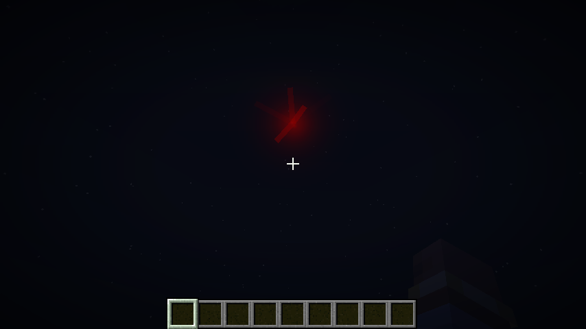 | **00:00 – 00:08 · La Agonía Sangrienta.** Betelgeuse se convulsiona como mercurio hirviendo y lanza llamaradas. A los 7 s colapsa y deja una negrura muerta. | Latido que acelera, temblor suave, silencio total antes del estallido. Nada dañino. |
| 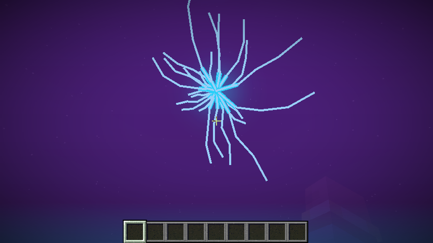 | **00:08 – 00:20 · El Latigazo Violento.** La cúpula se rompe con grietas cian; el cielo cambia a golpes de cian y violeta. | **Pulso de radiación** a quien está bajo el cielo; quien mira a la estrella entre 8,0 y 8,5 s queda ciego 3 s y recibe daño. |
| 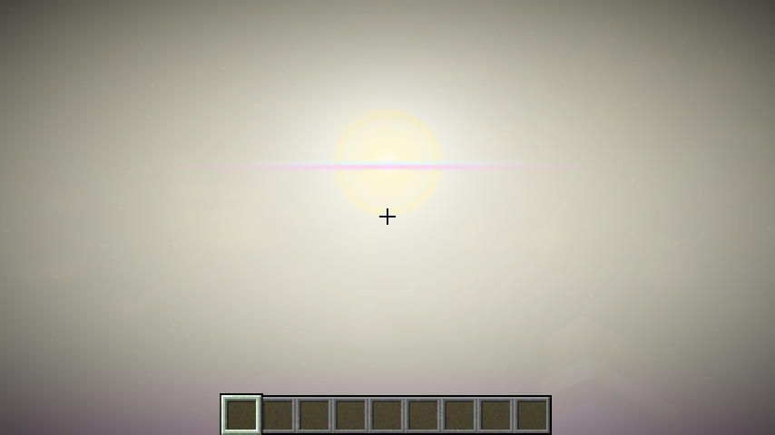 | **00:20 – 00:35 · El Sol Demonio.** Un sol blanco con corona dorada mata la noche; anillos de vapor rizan el cielo. | Whiteout según el perfil, quemaduras y fuego bajo el cielo, los no-muertos arden, **la nieve y el hielo se derriten**. |
| 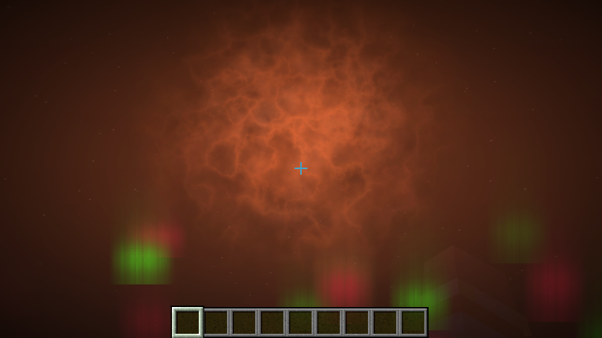 | **00:35 – 00:48 · La Tormenta de Plasma.** El plasma devora el cielo (blanco → naranja → púrpura podrido) y las auroras se cruzan en el cénit. | **Rayos** cerca de los jugadores expuestos (tope 12), radiación, la superficie se **chamusca** (15 % en gameplay, 35 % en cinematic). |
| 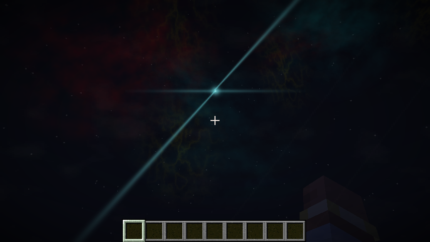 | **00:48 – 01:00 · La Cicatriz Eterna.** Queda una nebulosa con venas de hidrógeno y encajes de oxígeno; en su centro late un púlsar. | La radiación se apaga sola. Empiezan las secuelas. |

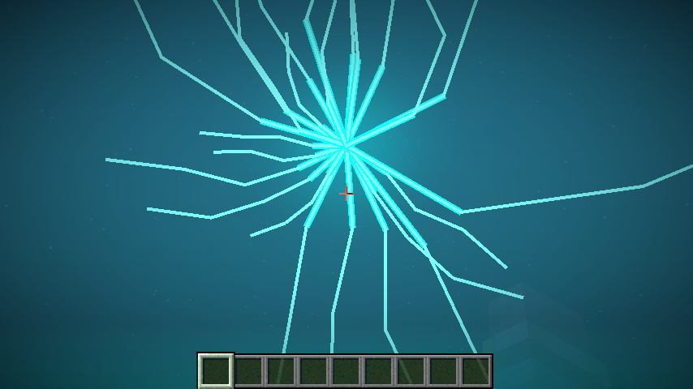

**Secuelas.** La nebulosa y el púlsar se quedan en el cielo (solo se ven de noche), también para quien entra después.
`/le scars list` y `/le scars clear` las gestionan.

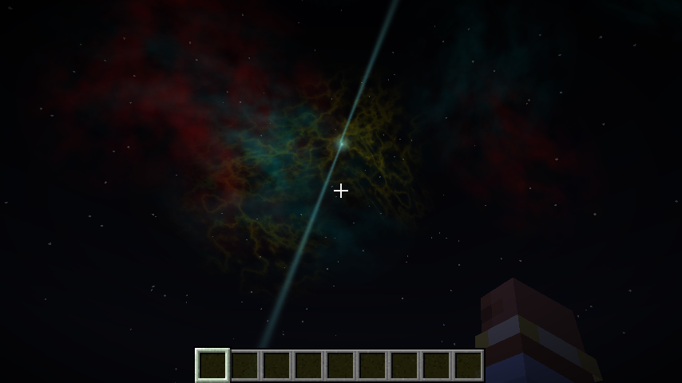

## Lluvia de meteoritos

`liveevents:meteor_shower` · **90 s** · localizado (centro + `radius`, 128) · parámetros: `radius`, `count` (40)

Estrellas fugaces cada vez más seguidas, un bólido verde que se parte en tres y después la lluvia: **cada impacto avisa
1,5 s antes con un círculo de brasas en el suelo**. Los cráteres tienen borde de basalto y fondo de magma que se
**enfría a obsidiana** a los 20 s. El estampido llega con retraso según la distancia.

| 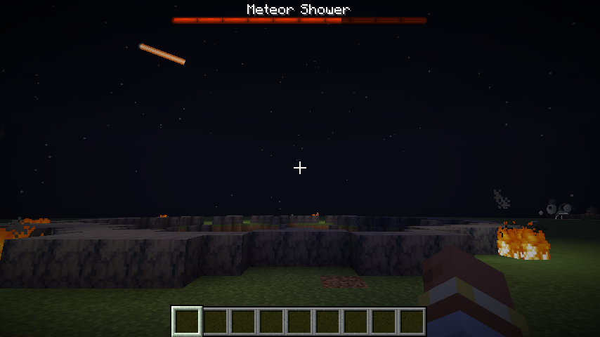 | 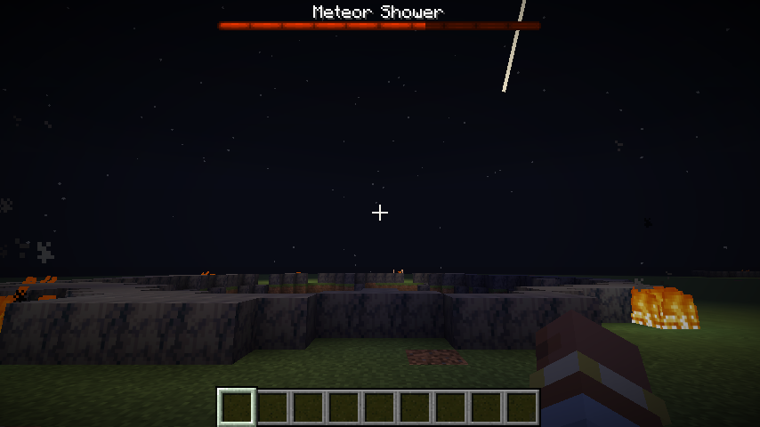 |
|---|---|

Daño `meteor_impact` con caída por distancia, empujón, lentitud breve y fuego. Los impactos solo cambian el terreno en
chunks cargados: un meteorito que cae en un chunk descargado se ve, pero no cambia nada.

## Terremoto

`liveevents:earthquake` · **45 s** · regional (epicentro + `radius`, 160)

Silencio, un golpe seco desde abajo (**onda P**) y después la tierra se abre (**onda S**). Cada cliente calcula su
propio retraso según la distancia al epicentro. Una grieta recorre una línea de falla determinista, la grava y la arena
sin soporte caen (registradas en el diario: se pueden revertir), las estalactitas se desprenden y hacen daño, y cerca del
epicentro hay náusea, lentitud y empujones. En `safe` no hay náusea y el temblor baja al 30 %.

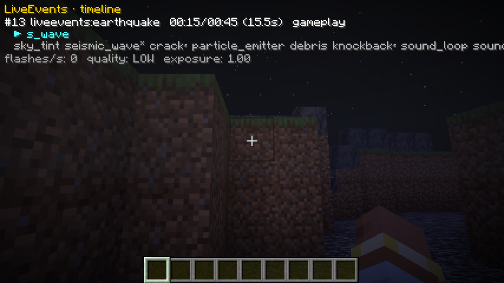

## Aurora boreal

`liveevents:aurora_borealis` · **120 s** · celeste · **inofensiva**

Una noche tranquila de cortinas verdes, turquesa y violetas que nacen en los horizontes norte y sur. Pensada para series
y capturas: no daña ni cambia el mundo.

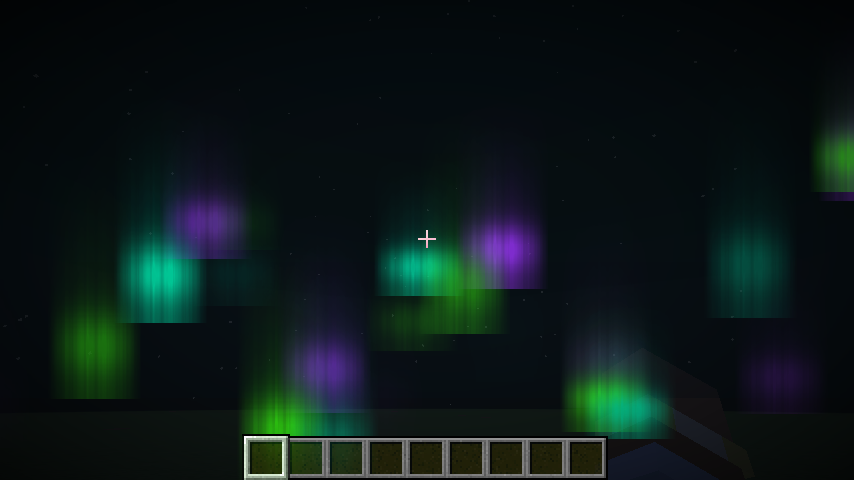

## Eclipse total

`liveevents:total_eclipse` · **90 s** · celeste · no letal

Primer contacto, **totalidad** (oscuridad, corona fantasmal y horizonte rojizo, la música calla), el **anillo de
diamante** (un destello suave, limitado en `safe`) y la vuelta de la luz.

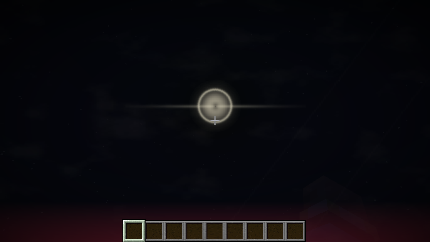

## Tormenta solar

`liveevents:solar_storm` · **75 s** · celeste · letal

Una llamarada en el este y después una tormenta magnética: auroras intensas, radiación periódica a quien está bajo el
cielo y algunos rayos.

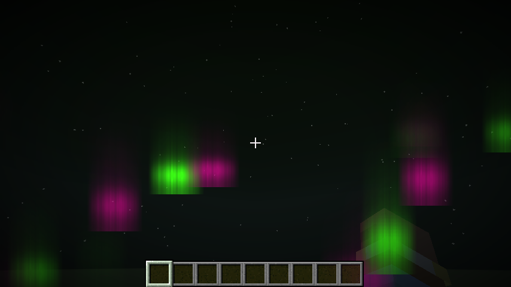

## Gran meteorito

`liveevents:great_meteor` · **40 s** · localizado · letal

Un único bólido enorme con aviso de 3 s: cráter de radio 9, onda expansiva de 96 bloques, escombros, empujón y una nube
de polvo que tarda en posarse.

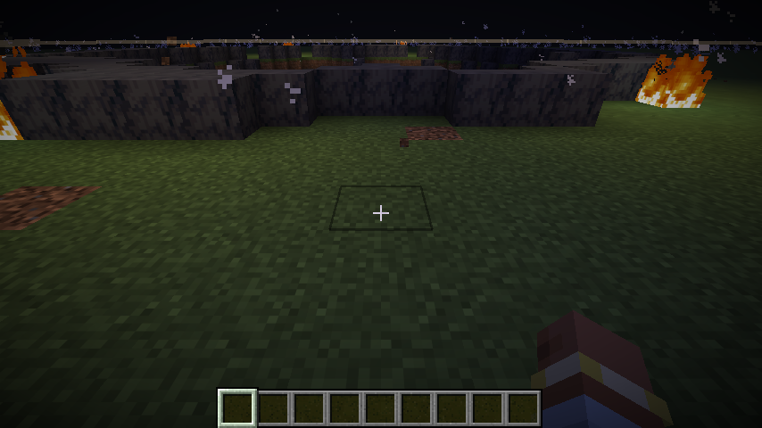

## Ventisca

`liveevents:blizzard` · **90 s** · regional · letal

Un frente frío y un muro blanco de nieve: casi sin visibilidad, lentitud a la intemperie y el agua de la superficie se
congela (registrado en el diario).

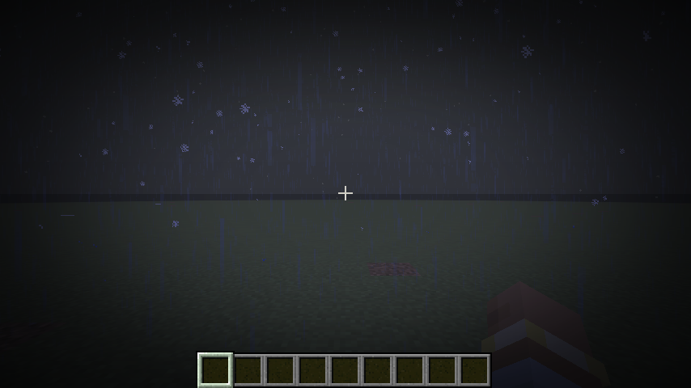

## Lluvia ácida

`liveevents:acid_rain` · **80 s** · regional · letal

Nubes tóxicas y un aguacero que quema la piel a quien está bajo el cielo (daño `acid`), marchita cultivos y flores y
corroe la superficie (paleta `liveevents:corroded`).

## Agujero negro

`liveevents:black_hole` · **60 s** · localizado · letal

Una singularidad con disco de acreción **atrae a todo lo que hay en 32 bloques** cada vez con más fuerza y, al final,
colapsa en un cráter de obsidiana.

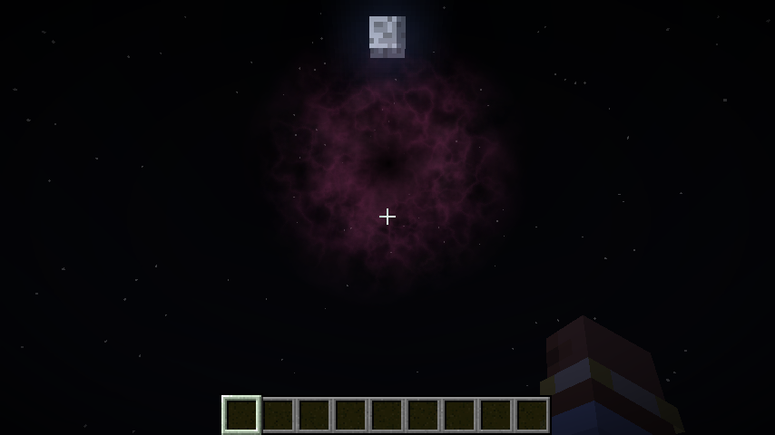

## Perfiles

El mismo instante (pico del sol demonio, 20,6 s) en los tres perfiles:

| cinematic | gameplay | safe |
|---|---|---|
| 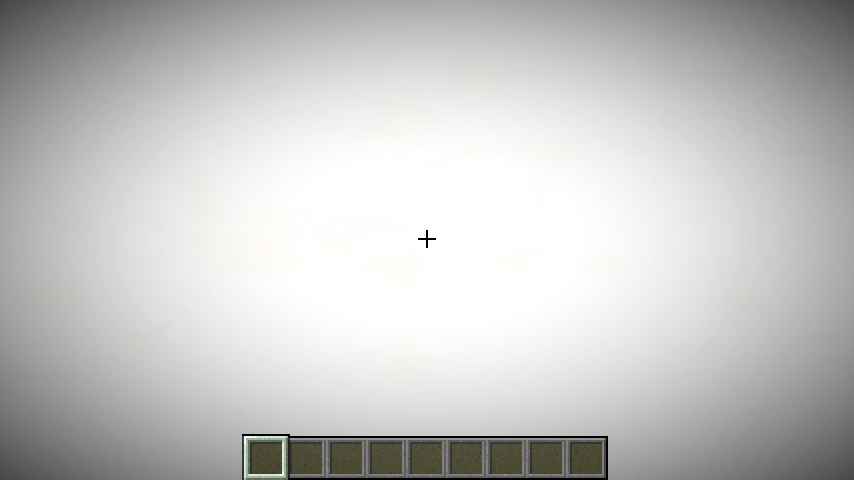 | 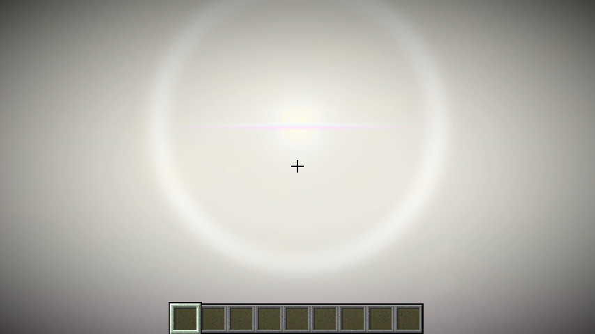 | 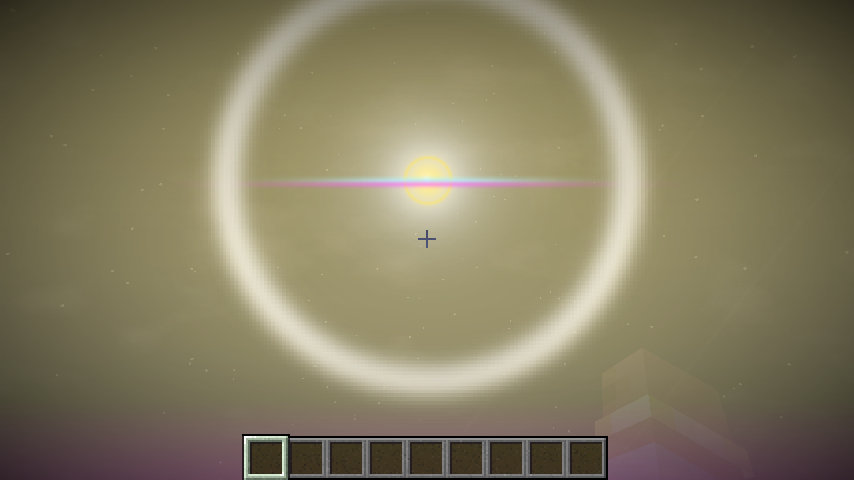 |

Ver [Perfiles y accesibilidad](perfiles-y-accesibilidad.md).

---

Creado por **TakumiStudios**.
