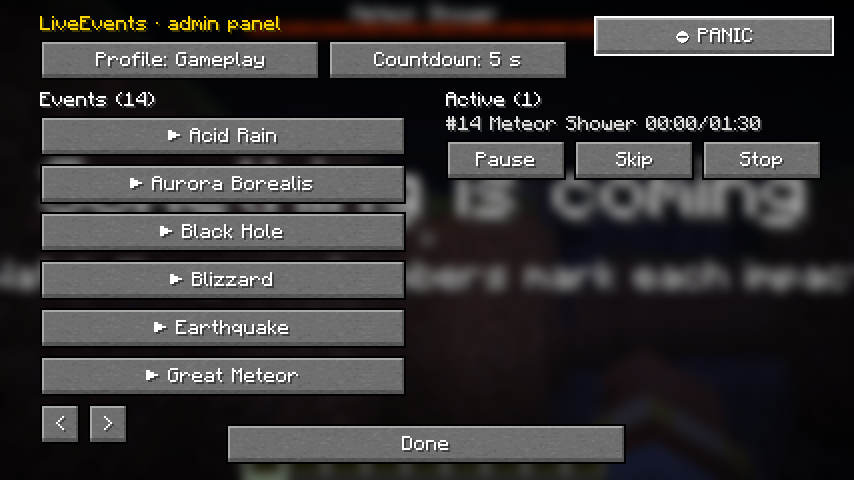

# Guía para administradores

## Lanzar un evento

```mcfunction
/le start supernova
```

Sin más opciones, el evento empieza en tu posición, en tu dimensión y con el perfil por defecto (`gameplay`). Las
opciones se escriben detrás, en cualquier orden:

```mcfunction
/le start meteor_shower at 120 70 -340 radius=96 count=60 delay 10 profile=cinematic
/le start earthquake on Steve
/le start supernova in the_end queue
```

| Opción | Qué hace |
|---|---|
| `at <x> <y> <z>` | Centro del evento (admite `~` relativas) |
| `on <jugador o selector>` | Centro en un jugador (`@r`, `@p`, un nombre…) |
| `in <dimensión>` | Otra dimensión (`the_end`, `minecraft:overworld`…) |
| `delay <segundos>` | Cuenta atrás en la barra de acción antes de empezar (hasta 3600 s) |
| `profile=cinematic\|gameplay\|safe` | Perfil de intensidad ([Perfiles y accesibilidad](perfiles-y-accesibilidad.md)) |
| `timescale=<0.1–2.0>` | Cámara lenta o rápida (para quien crea eventos) |
| `<parámetro>=<número>` | Parámetros del evento (`radius`, `count`…; `/le info <evento>` los lista) |
| `queue` | Si hay un evento incompatible activo, ponerlo en cola en vez de rechazarlo |
| `confirm` | Confirmar en mundos hardcore (los eventos letales lo piden) |

Lanzar en otra posición o dimensión necesita el permiso `liveevents:start.anywhere` (OP 3) si lo hace un jugador. Desde
la consola, bloques de comandos y funciones no hace falta.

## Probar sin riesgo: `/le preview`

```mcfunction
/le preview supernova profile=safe
```

Reproduce los **visuales y el sonido solo para ti**: no hay efectos de juego, el mundo no cambia y los demás jugadores
no ven nada. Es la forma de ensayar antes de un directo.

## Durante el evento

```mcfunction
/le list active          # instancias activas: número, tiempo, fase y perfil
/le pause 3              # congela el evento (visuales y sonido incluidos)
/le resume 3
/le skip 3               # salta a la fase siguiente
/le skip 3 demon_sun     # salta a una fase concreta
/le set 3 radius 64      # cambia un parámetro en vivo
/le stop 3               # cancela
/le stop all confirm     # cancela todos
```

El número de instancia (`#3`) aparece al lanzar y en `/le list active`.

## Parada de emergencia: `/le panic`

Un solo comando, pensado para usarlo en un directo sin pensar:

1. Detiene **todas** las instancias de todas las dimensiones.
2. Corta **al instante** en todos los clientes el post-procesado, los destellos, el temblor y el sonido.
3. Vacía la cola de cambios de bloques y quita los efectos de estado del mod.
4. **No revierte** el mundo (eso se decide después con `/le revert`).
5. Lo anota en el registro de auditoría.

Dale el permiso `liveevents:panic` también a los moderadores del directo. Cada jugador tiene además su propia
**tecla de pánico** (sin asignar por defecto, en *Controles → LiveEvents*).

## Deshacer cambios en el mundo: `/le revert`

Todo cambio de bloque de un evento se apunta en un **diario en disco** (`<mundo>/liveevents/journal/`), así que se puede
revertir incluso después de reiniciar el servidor.

```mcfunction
/le revert list               # diarios guardados
/le revert last               # pide confirmación y muestra cuántos cambios hay
/le revert last confirm
/le revert 3 confirm          # el diario de la instancia #3
```

- La reversión es **gradual** (mismo presupuesto por tick que los eventos).
- Solo restaura las posiciones que siguen con el bloque que puso el evento: **si un jugador construyó encima, no se
  toca**.
- Las posiciones en chunks descargados se cuentan aparte; vuelve a ejecutar el comando cuando estén cargados.
- Cada evento elige qué pasa al terminar (`world_mode`): `revert_manual` (por defecto, decides tú), `revert_on_end`
  (se revierte solo) o `permanent` (sin diario).
- Los diarios caducan a los 7 días (`journal_expiry_days`).

> **Recomendación:** haz una copia de seguridad del mundo antes de un evento grande. El diario cubre los cambios del
> mod, pero no lo que pase alrededor (mobs, explosiones vanilla o acciones de los jugadores).

## Qué protege el mod

- Nunca carga chunks: solo cambia bloques en chunks ya cargados.
- Nunca toca bloques con *block entity* (cofres, hornos…), bedrock, portales ni la tag `#liveevents:immune` (los
  modpacks pueden ampliarla).
- Zonas excluidas en `server.json` (`excluded_regions`) y la API `BeforeBlockChange` para mods de protección.
- `lethal: false` en un evento: su daño nunca baja a nadie de medio corazón (ideal para series).
- En mundos hardcore, los eventos letales piden `confirm`.
- Creativo y espectador no reciben efectos de juego; el permiso `liveevents:bypass.damage` hace inmune a quien lo tenga.
- Al reaparecer en mitad de una fase dañina hay unos segundos de gracia (`respawn_grace_seconds`).

## Varios eventos a la vez

- Como máximo `max_concurrent_events` instancias (2 por defecto).
- Solo **un evento celeste por dimensión** (supernova, eclipse…). El segundo se rechaza o, con `queue`, espera su turno.
- Un celeste y uno localizado (supernova + meteoritos) sí pueden convivir: el cielo lo pone el celeste.
- Los tintes, la luz y el temblor se mezclan por intensidad (el temblor más fuerte gana; no se suman) y la regla de
  destellos se cuenta entre todos los eventos.

## Reinicios y servidor vacío

- Al cerrar el servidor se guardan las instancias activas. Con `on_restart: cancel` (por defecto) no se reanudan; con
  `resume` siguen desde el segundo en que se quedaron.
- El diario y las secuelas del cielo se conservan siempre.
- Con `pause_when_empty`, los eventos se pausan cuando el servidor **se queda** vacío y se reanudan al entrar alguien.
- El **watchdog** reduce el trabajo de los eventos si el servidor va saturado (`watchdog_mspt` durante
  `watchdog_seconds`) y, si no se recupera, los pausa y avisa a quien tenga `liveevents:notify`. Nunca cancela ni
  revierte por su cuenta.

## Auditoría y diagnóstico

- `logs/liveevents-audit-AAAA-MM-DD.log`: quién lanzó, paró o revirtió qué, cuándo, dónde y con qué parámetros. Se
  borra solo pasados `audit_retention_days` (30). No hay telemetría de ningún tipo.
- `/le debug perf`: coste del mod en el servidor por tick, cola pendiente y MSPT.
- `/le debug timeline`: overlay con el segundo actual, la fase y los módulos activos.
- `/le debug report`: informe para adjuntar a un *issue* (versiones, mods, configuración y errores, **sin datos
  personales**) en `logs/liveevents-report-*.txt`.


## Panel de administración: `/le gui`



Lista los eventos que puedes lanzar, con selector de perfil y cuenta atrás, las instancias activas con pausa, salto y
parada, y un botón de **pánico** siempre visible. Por dentro solo envía comandos normales, que el servidor comprueba con
permisos: no añade ningún poder nuevo.

---

Creado por **TakumiStudios**.
